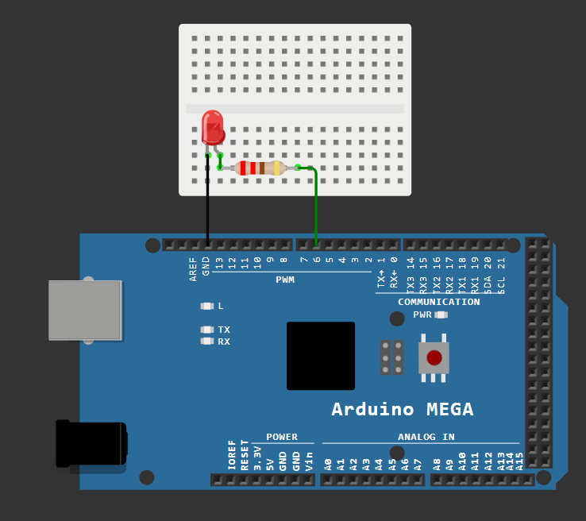

# Arduino LED Blink

A simple Arduino project that makes an LED blink.
The LED stays on for 0.5 s, then off for 0.5 s, in a loop.

## Hardware

- Arduino Mega
- 1 LED
- 1 resistor (220 Ω)
- Breadboard and jumper wires
- 2x Wire male-male

## Wiring

Pin 6 → resistor → LED long leg (+)
LED short leg (-) → GND

## How to use

1. Open `Arduino_LED_project.ino` in the Arduino IDE.
2. Select your board and port.
3. Click **Upload**.

## Change the blink speed

In the Arduino IDE, change the value inside `delay()` (in milliseconds), then upload again.

- First `delay()`: time the LED stays on.
- Second `delay()`: time the LED stays off.

Example: `delay(1000);` = 1 second.
